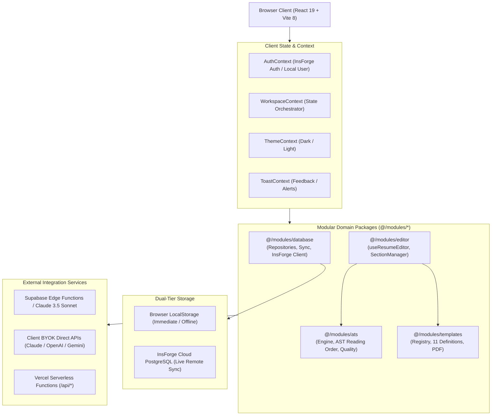
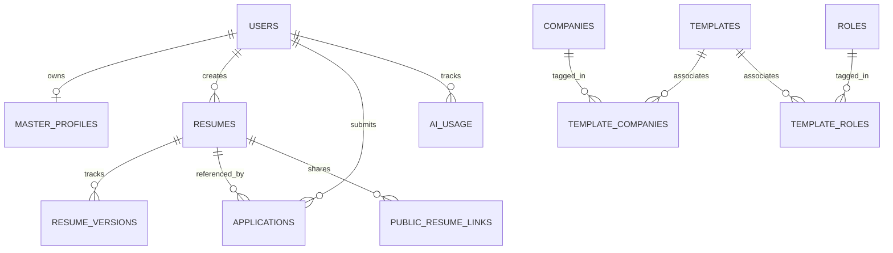

# ResumeForge — Technical Architecture

> **Document Version:** 1.0.0  
> **Target Audience:** Engineering, AI Coding Agents, Architecture Review  
> **Status:** Active / Source of Truth  
> **Last Verified:** October 2026  

---

## 1. System Overview

ResumeForge is built with a **modular, local-first single-page application (SPA)** architecture paired with a cloud-synchronized PostgreSQL backend. The application decouples pure business logic (ATS evaluation, text extraction, template compilation, repository storage) from React UI components, enabling fast client-side rendering, instant offline resilience, zero-latency live preview, and high-fidelity PDF compilation.



---

## 2. Technology Stack (Verified from Codebase)

| Layer | Technology | Details / Version |
| :--- | :--- | :--- |
| **Framework & UI** | React 19 + React DOM | v19.3.1 (`react`, `react-dom`) |
| **Build & Tooling** | Vite 8 + Rolldown | v8.3.4 (`vite`, `@vitejs/plugin-react`) |
| **Language** | TypeScript | v6.0.3 (`typescript`, `tsc -b`) |
| **Styling** | Tailwind CSS v3 | v3.4.17 with `@tailwindcss` color palette & CSS dark mode |
| **Routing** | React Router DOM | v7.18.4 (`react-router-dom`) |
| **Icons & Motion** | Lucide React & Framer Motion | `lucide-react` v1.59, `framer-motion` v14.4 |
| **PDF Generation** | @react-pdf/renderer | v4.9.0 (Pure vector PDF stream generation) |
| **PDF Parsing & OCR** | PDF.js | `pdfjs-dist` v6.4.299 |
| **Cloud Database** | InsForge PostgreSQL | Direct PostgreSQL & `@insforge/sdk` v1.5.2 |
| **Serverless & Edge** | Vercel Serverless & Supabase Edge | Vercel `/api/*` endpoints + Edge Function `claude-ai` |
| **Linter** | Oxlint | v1.88.0 (`oxlint`) |

---

## 3. Directory Structure & Modular Layout

The repository organizes source files under `src/` with clear domain separation into four decoupled modules:

```
src/
├── App.tsx                      # Top-level Router, Global Providers & Route Definitions
├── main.tsx                     # Entry point mounting App to DOM
├── index.css                    # Tailwind CSS imports & base typography styles
├── modules/                     # Decoupled Domain Modules (@/modules/*)
│   ├── database/                # Database Services Module
│   │   ├── core/                # InsForge client initialization & 401 session interceptors
│   │   ├── repositories/        # StorageService, ResumeRepository, ProfileRepo, AppRepo
│   │   └── index.ts             # Public Barrel API
│   ├── ats/                     # ATS Compatibility & Quality Module
│   │   ├── core/                # Pure logic: atsEngine, readingOrder, textExtractor, qualityEngine
│   │   ├── components/          # Visual overlays: ATSInspectorOverlay, RecruiterScanSimulator
│   │   └── index.ts             # Public Barrel API
│   ├── templates/               # Resume Templates & PDF Engine
│   │   ├── definitions/         # 11 Standardized Templates (Classic, Modern, Compact, etc.)
│   │   ├── core/                # TemplateRegistry mapping IDs to React components
│   │   ├── components/          # ResumeDocument, ResumePDF, LivePreviewCanvas, ZoomControls
│   │   └── index.ts             # Public Barrel API
│   └── editor/                  # Resume Drafting & Form Controls
│       ├── hooks/               # useResumeEditor.ts (Autosave, debouncing, reordering)
│       ├── components/          # ResumeFormManager, SectionManager, Bullet/XYZ modals
│       └── index.ts             # Public Barrel API
├── context/                     # Shared React Contexts
│   ├── AuthContext.tsx          # InsForge Auth, Google OAuth, Local/Guest user session
│   ├── WorkspaceContext.tsx     # MasterProfile, Resumes, Applications, Version Snapshots
│   └── ThemeContext.tsx         # Dark / Light class-based theme provider
├── pages/                       # Route Page Orchestrators
│   ├── LandingPage.tsx          # Marketing showcase & interactive ATS scanner
│   ├── LoginPage.tsx            # Email sign-in/up & Google OAuth launcher
│   ├── DashboardPage.tsx        # Overview stats, quick actions, recent resumes
│   ├── MasterProfilePage.tsx    # Single source of truth profile manager
│   ├── ResumesPage.tsx          # Resume grid, duplication, trash manager
│   ├── ResumeEditorPage.tsx     # Clean orchestrator for editing + live preview
│   ├── ResumeAnalyzerPage.tsx   # Detailed ATS report & text extraction viewer
│   ├── ApplicationsPage.tsx     # Kanban application tracking with immutable snapshots
│   ├── AIToolsPage.tsx          # Job description tailoring & honest bullet optimizer
│   ├── CompanyTemplatesPage.tsx # Curated company-wise template directory
│   ├── PublicResumePage.tsx     # Read-only public share view (/r/:slug)
│   ├── PortfolioPage.tsx        # Hosted portfolio web page (/portfolio)
│   └── SettingsPage.tsx         # Storage, privacy, and account settings
├── services/                    # Autonomous agents & template services
│   ├── companyTemplateService.ts
│   └── resumeLibraryAgent.ts
└── data/types/                  # Centralized TypeScript Data Models
```

---

## 4. Frontend Routing Architecture

Configured in [`src/App.tsx`](file:///C:/project/src/App.tsx) using `react-router-dom`:

| Route Path | Page Component | Access Level | Description |
| :--- | :--- | :--- | :--- |
| `/` or `/landing` | `LandingPage` | Public | High-impact interactive marketing page & live ATS scanner demo. |
| `/login` | `LoginPage` | Public | Auth screen for Google OAuth and password/passwordless login. |
| `/templates` | `CompanyTemplatesPage` | Public / Auth | Curated company-wise resume templates directory. |
| `/dashboard` | `DashboardPage` | Protected | Primary student dashboard with metrics, deadlines, and resumes. |
| `/profile` | `MasterProfilePage` | Protected | Single source of truth career repository. |
| `/resumes` | `ResumesPage` | Protected | All created resumes, search, duplicate, archive, and trash. |
| `/editor/:id` | `ResumeEditorPage` | Protected | Real-time resume builder with side-by-side preview. |
| `/analyzer/:id` | `ResumeAnalyzerPage`| Protected | ATS compatibility report, quality audit, and raw text stream. |
| `/applications` | `ApplicationsPage` | Protected | Job applications pipeline with Kanban & table views. |
| `/ai` | `AIToolsPage` | Protected | Job description match analyzer & honest bullet improver. |
| `/portfolio` | `PortfolioPage` | Protected | Instant web portfolio with QR code & themes. |
| `/settings` | `SettingsPage` | Protected | Privacy controls, cloud sync diagnostics, data reset. |
| `/admin/templates`| `AdminTemplateDashboardPage` | Protected | Admin curation for company template library. |
| `/r/:slug` | `PublicResumePage` | Public | Unlisted or public share link for recruiter review. |

---

## 5. State Management & Persistence

ResumeForge operates a **dual-tier persistence architecture**:

1. **Tier 1: Synchronous Local-First Storage (`LocalStorage`)**
   - Managed via [`StorageService`](file:///C:/project/src/modules/database/repositories/storageService.ts).
   - Keys:
     - `resumeforge_master_profile`: Full master career profile JSON.
     - `resumeforge_resumes`: Array of all user resumes.
     - `resumeforge_applications`: Job application tracking records.
     - `resumeforge_ai_usage`: Daily AI quota counter and request logs.
     - `resumeforge_public_links`: Active public sharing slugs.
     - `resumeforge_current_user`: Cached session state for guest/local mode.
   - **Advantage:** Instant page load, zero latency on user input, and offline execution.

2. **Tier 2: Asynchronous Cloud Database Synchronization (`InsForge PostgreSQL`)**
   - When an authenticated user logs in, [`WorkspaceContext`](file:///C:/project/src/context/WorkspaceContext.tsx) hydrators automatically pull remote tables (`resumes`, `master_profiles`, `applications`) from InsForge PostgreSQL.
   - Debounced saves (`useResumeEditor`) persist local state immediately, then asynchronously push changes to the remote database via repository callers.
   - 401 Session Interception: If a JWT token expires during background sync, [`onSessionExpired`](file:///C:/project/src/modules/database/core/insforgeClient.ts) intercepts the response, notifies the user, and initiates graceful re-authentication without data loss.

---

## 6. Authentication & Authorization

Implemented via [`AuthContext.tsx`](file:///C:/project/src/context/AuthContext.tsx) utilizing the InsForge Authentication SDK (`@insforge/sdk`):

- **Google OAuth:** Invoked via `insforge.auth.signInWithOAuth({ provider: 'google', redirectTo })`.
- **Email / Password:** Authenticated against `insforge.auth.signInWithPassword`.
- **Guest / Local Fallback:** When InsForge is unconfigured or offline, users can continue creating resumes in guest mode with unique local IDs (`user_${Date.now()}`).
- **Row-Level Security (RLS):** Every database query incorporates `auth.uid() = user_id`, guaranteeing cross-tenant data isolation.
- **Public Share Authorization:** Unauthenticated visitors can view published resumes exclusively through `/r/:slug` where `access_type IN ('public', 'unlisted')`.

---

## 7. Database Tables & Relationships

Database tables are defined in [`supabase/schema.sql`](file:///C:/project/supabase/schema.sql) and versioned under `supabase/migrations/`:



### Table Definitions

1. `profiles`: Extends user identities (ID, email, full name, avatar URL, timestamps).
2. `master_profiles`: Central career archive storing `personal_info`, `education`, `experience`, `projects`, `skills`, `certifications`, `achievements`, `hackathons`, `volunteering`, `open_source`, and `publications` as structured `JSONB`.
3. `resumes`: Target-specific resumes containing structured `ResumeData` in column `data (jsonb)`, `target_role`, `target_company`, `is_archived`, and `is_trash`.
4. `resume_versions`: Historical snapshots for rollbacks (`resume_id`, `version_number`, `data`, `note`).
5. `applications`: Application pipeline tracking (`company`, `role`, `status`, `deadline`, `resume_id`, `resume_snapshot`). Note: `resume_snapshot` captures the exact resume JSON when moved to "Applied".
6. `ai_usage`: Enforces a 20 calls/day quota per user (`user_id`, `usage_date`, `calls_count`, `max_daily_calls`).
7. `public_resume_links`: Unique random slugs for sharing (`slug`, `resume_id`, `access_type`, `views_count`).
8. `portfolio_profiles`: Student portfolio site settings (`slug`, `tagline`, `bio`, `theme`, `show_qr_code`).
9. `companies`, `roles`, `templates`, `template_companies`, `template_roles`, `template_sources`: Company-wise curated template repository supporting verified layouts, licensing sources, and recruiter requirements.

### Database Migration Rules
- Any schema adjustments must be written as sequential, idempotent SQL migration files under `supabase/migrations/` (format: `YYYYMMDDHHMMSS_description.sql`).
- **Never** drop existing tables, columns, or user data. Use backward-compatible additions with safe default values.

---

## 8. ATS Analysis & Text Extraction Architecture

The ATS analyzer located in [`src/modules/ats/core/`](file:///C:/project/src/modules/ats/core/) operates purely in memory without DOM dependencies:

1. **AST Reading Order Engine (`readingOrder.ts`):**
   - Analyzes `resume.meta.sectionOrder` and filters out `hiddenSections` or empty sections.
   - Calculates visual reading sequence (`#01..#0N`) to confirm that human recruiters and machine parsers consume sections in identical order.
2. **Raw Text Stream Extractor (`textExtractor.ts`):**
   - Converts structured `ResumeData` into a raw, linear character stream, mimicking parser text scraping (e.g. Workday/Taleo OCR).
   - Validates that contact details are string-formatted rather than masked by non-renderable characters.
3. **Compliance Scoring Engine (`atsEngine.ts`):**
   - Runs 10+ deterministic checks: contact info completeness, single-column validation, date format standardization, standard header matching, and bullet verb density.
   - Yields a weighted 0–100 score across 5 categories: `parsing`, `structure`, `contactInfo`, `formatting`, and `sections`.
4. **Quality Engine (`qualityEngine.ts`):**
   - Identifies weak verbs (e.g., "helped", "worked on") and suggests power verbs ("architected", "orchestrated", "engineered").
   - Flags vague statements lacking metrics and detects duplicate technical skills.

---

## 9. PDF Generation & Preview Architecture

```
[ResumeData State]
        │
        ├──> React DOM View (LivePreviewCanvas.tsx)
        │       └── Standardized HTML/CSS components with A4 sizing
        │
        └──> Pure Vector PDF (@react-pdf/renderer)
                └── ResumePDFDocument / ClassicResumePDFPage
                        └── Client-side Blob generation (downloadResumePDF)
```

- **Zero html2canvas Dependency:** Rather than converting DOM elements to blurry raster images, [`ResumePDF.tsx`](file:///C:/project/src/modules/templates/components/ResumePDF.tsx) directly constructs a pure vector document using `@react-pdf/renderer` primitives (`<Document>`, `<Page>`, `<View>`, `<Text>`).
- **Searchable Text:** Fonts (Helvetica, Helvetica-Bold) are embedded directly into the PDF. All headings, contact links, and bullet points are selectable and copy-pasteable.
- **Client-Side Trigger:** The `downloadResumePDF(resume)` function compiles the PDF buffer entirely in the browser thread, converts it to an object URL blob, and triggers a clean native download.

---

## 10. AI Integration & Anti-Hallucination Safeguards

ResumeForge incorporates a strict **multi-tiered AI architecture**:

1. **Local Deterministic Honest Engine (Default):**
   - Executes instantaneously without external API keys or cost.
   - Verifies all bullet point rewrites against the candidate's actual projects, technologies, and achievements in `MasterProfile`.
   - Rephrases statements using the Google XYZ Formula: `[Action Verb] + [Specific Task & Tools] + [Measurable Impact]`.
2. **Supabase Edge Function (`claude-ai`):**
   - Serverless invocation for deep semantic job description matching.
   - Analyzes match percentages and highlights genuine skill gaps without generating fabricated experience.
3. **Bring-Your-Own-Key (BYOK) Client LLM:**
   - In [`AIChatWidget.tsx`](file:///C:/project/src/components/chat/AIChatWidget.tsx), users can input their personal Claude, OpenAI, or Gemini key.
   - Keys are stored **exclusively in `localStorage`** (`resumeforge_custom_api_key`) and dispatched directly to provider endpoints without touching an intermediary backend.
4. **Privacy Consent Check:**
   - No data is dispatched to any AI service until the user explicitly accepts the AI Privacy Notice via [`StorageService.hasAcceptedAIPrivacy()`](file:///C:/project/src/modules/database/repositories/storageService.ts).

---

## 11. Environment Variables & Secrets Management

Environment configuration is declared in [`.env.example`](file:///C:/project/.env.example):

| Variable | Scope | Description |
| :--- | :--- | :--- |
| `VITE_INSFORGE_URL` | Client (Public) | InsForge project base URL for PostgreSQL and Auth API. |
| `VITE_INSFORGE_KEY` | Client (Public) | InsForge anonymous public API key. |
| `DATABASE_URL` | Server (Private) | Direct PostgreSQL connection string used for CLI migrations. |
| `INSFORGE_SERVICE_KEY` | Server (Private) | Privileged server key used exclusively in Vercel serverless functions (`api/*`). |

**Security Rules:**
- Never commit `.env` or production credentials to Git.
- Never prefix sensitive keys (such as `INSFORGE_SERVICE_KEY` or `DATABASE_URL`) with `VITE_`.
- Google OAuth secrets are managed exclusively inside the InsForge and Google Cloud dashboards—never in application code.

---

## 12. Build, Deployment & Verification Pipeline

- **Local Development:** `npm run dev` (Vite 8 development server).
- **Type Checking & Production Build:** `npm run build` (`tsc -b && vite build`). Generates optimized static assets in `dist/`.
- **Linting:** `npm run lint` (`oxlint`).
- **Production Hosting:** Vercel with SPA fallback rewrites and API serverless routes configured in [`vercel.json`](file:///C:/project/vercel.json).
- **Automated Verification:** Standalone verification suites in `scratch/verify_modular_architecture.ts` validate database CRUD, AST reading order calculation, template registry lookup, and PDF export integrity.
