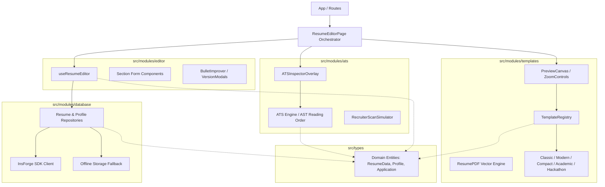

# Design

## Context

ResumeForge is currently structured as a standard single-package React 19 + Vite application. The codebase has grown organically:
- `src/pages/ResumeEditorPage.tsx` acts as a monolithic controller of ~1,000 lines containing drafting state, autosave timers, section management, versioning modals, and template rendering.
- Templates in `src/components/resume/templates/` are tightly coupled with resume PDF rendering in `src/components/resume/ResumePDF.tsx`.
- ATS calculation utilities in `src/lib/atsAnalyzer.ts` and `src/lib/qualityAnalyzer.ts` mix scoring algorithms with UI helper logic.
- Storage and database operations in `src/lib/storage.ts` handle multi-table PostgREST requests alongside offline local storage fallbacks without a formal repository boundary.

See `proposal.md` for the motivation and high-level scope. See `specs/` for capability behavior contracts.

## Goals / Non-Goals

**Goals:**
- Partition the codebase into four decoupled domain modules under `src/modules/`: `editor/`, `templates/`, `ats/`, and `database/`.
- Enforce public API boundaries for each module using barrel exports (`index.ts`), preventing deep imports into internal files.
- Decouple the ATS calculation engine from React UI components to enable headless unit testing.
- Isolate template definitions behind a unified `TemplateRegistry` and `ResumeTemplateProps` contract.
- Encapsulate data access behind typed repositories (`ResumeRepository`, `ProfileRepository`, `ApplicationRepository`).
- Ensure zero breaking changes to application runtime behavior, existing routes, and zero TypeScript build errors.

**Non-Goals:**
- Converting the repository into a multi-package monorepo (e.g., pnpm workspaces, Turborepo, or Nx). In-repo folder modularization achieves domain separation without build tool complexity.
- Redesigning template visuals, changing ATS scoring algorithms, or altering database schema tables.
- Modifying Google OAuth authentication workflows or protected route guards.

## Decisions

### 1. In-Repo Modular Architecture (`src/modules/*`) vs. Multi-Package Monorepo
- **Decision**: Organize modules under `src/modules/{editor, templates, ats, database}` with strict barrel files (`index.ts`) rather than setting up a monorepo with multiple `package.json` files.
- **Rationale**: A monorepo introduces tooling overhead (workspace package linking, build orchestrator config, deployment pipeline changes on Vercel). Modular folders within Vite deliver 100% of the architectural separation and domain isolation with zero risk to existing build and deployment pipelines.
- **Alternatives Considered**:
  - *pnpm / npm workspaces*: Rejected due to unnecessary configuration complexity for a single deployed web application.

### 2. Module Directory Structure & Barrel Exports
- **Decision**: Each module follows a standardized internal layout:
  ```
  src/modules/<module-name>/
  ├── components/    # Module-specific presentation elements
  ├── hooks/         # React lifecycle & state hooks
  ├── core/          # Pure business logic / calculations (framework-agnostic)
  ├── types/         # Domain-specific internal types
  └── index.ts       # Public API: only exported symbols are consumed by outside code
  ```
- **Rationale**: Standardizing module layouts provides predictable navigation for developers and ensures pure logic remains separate from presentation. Barrel exports enforce encapsulation.
- **Alternatives Considered**:
  - *Flat folders*: Rejected because mixing components, hooks, and pure algorithms makes testing and boundary enforcement difficult.

### 3. Separation of ATS Core Engine and Visual Overlay
- **Decision**: Split ATS functionality into pure computational functions (`src/modules/ats/core/atsEngine.ts`, `readingOrder.ts`, `keywordMatcher.ts`) and React visual overlays (`src/modules/ats/components/ATSInspectorOverlay.tsx`, `RecruiterScanSimulator.tsx`).
- **Rationale**: The AST reading order indexer `#01..#0N` and ATS score algorithms must be verifiable in automated test suites without mocking React DOM or component trees.
- **Alternatives Considered**:
  - *Keep ATS logic inside React hooks*: Rejected because testing scoring heuristics would require rendering hooks within test harnesses.

### 4. Template Registry & Unified Template Contract
- **Decision**: Introduce a `TemplateRegistry` mapping template identifiers (`classic`, `modern`, `compact`, `academic`, `hackathon`) to standardized template components implementing `ResumeTemplateProps`.
- **Rationale**: Allows the preview canvas and PDF generator to render any template dynamically without hardcoded switch-case branches in pages. Adding new templates in the future becomes a simple registry registration.
- **Alternatives Considered**:
  - *Direct imports in ResumeEditorPage*: Current approach; rejected because it couples the editor to every individual template implementation.

### 5. Repository Pattern for Database Services
- **Decision**: Introduce repository interfaces (`ResumeRepository`, `MasterProfileRepository`, `ApplicationRepository`) in `src/modules/database/repositories/` backed by `InsForgeClient` and local storage synchronization.
- **Rationale**: Hides raw PostgREST requests, multi-tenant `user_id` filtering, and fallback storage mechanisms behind clean asynchronous methods (`getById`, `save`, `list`, `createSnapshot`).
- **Alternatives Considered**:
  - *Keep monolithic `storage.ts`*: Rejected because it spans 28KB and intermingles data types, serialization, and PostgREST calls for all tables.

## Architecture & Data Flow



## Risks / Trade-offs

- **[Risk: Broken internal imports during migration]** → *Mitigation*: Migrate modules in dependency order (shared contracts → database → ats → templates → editor), maintaining temporary compatibility re-exports in legacy paths until all consumers are updated.
- **[Risk: Circular dependency between Editor and Template Preview]** → *Mitigation*: Enforce a strict one-way dependency rule: `editor` and `templates` never import each other; both import shared contracts from `src/types/` and interact through the orchestrating page or context.
- **[Risk: TypeScript compiler errors in build pipeline]** → *Mitigation*: Run `npm run build` after each module migration to immediately catch missing exports or incorrect type imports.

## Migration Plan

1. **Scaffold Modular Folders**: Create `src/modules/{database,ats,templates,editor}/` with internal folders (`components/`, `core/`, `hooks/`, `types/`, `index.ts`).
2. **Migrate Database Services**: Move `storage.ts`, `insforge.ts`, `supabase.ts` into `src/modules/database/`, exposing clean repository APIs.
3. **Migrate ATS Analyzer**: Move `atsAnalyzer.ts`, `qualityAnalyzer.ts`, `ATSInspectorOverlay.tsx`, `RecruiterScanSimulator.tsx` into `src/modules/ats/`.
4. **Migrate Templates & Preview**: Move template components, `ResumeDocument.tsx`, `ResumePDF.tsx` into `src/modules/templates/` with `TemplateRegistry`.
5. **Migrate Resume Editor**: Refactor `ResumeEditorPage.tsx` into composed components and hooks inside `src/modules/editor/`.
6. **Verify Clean Imports & Build**: Validate all consumers across pages, remove obsolete legacy files, and confirm `npm run build` succeeds with zero errors.
